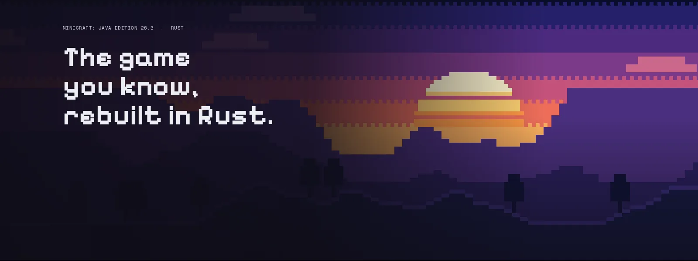
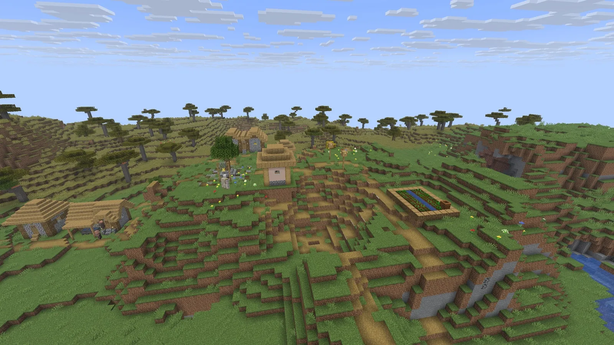
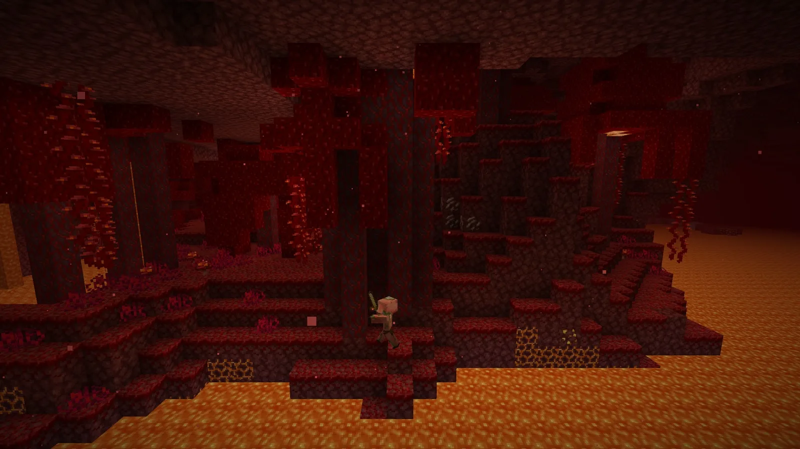

# Horizon for Termux (`aarch64-linux-android`)

Native Rust Minecraft: Java Edition 26.3 client (`horizon-official`) and resource preparer (`horizon-prepare`) patched for Termux (`bionic`) with Wayland/X11 windowing and Mesa Turnip / PanVK Vulkan support.
## DISCLAIMER: this fork is an atrocious piece of vibe coding, use at your own risk
## Install on Termux

1. Download the `.deb`:
   ```bash
   pkg install ./horizon-termux_0.1.*_aarch64.deb
   ```
2. For Adreno GPUs, install the Mesa Turnip ICD (if not already installed):
   ```bash
   pkg install mesa-vulkan-icd-freedreno
   ```

## Prepare Minecraft 26.3 Resources & Launch

1. Using an existing Minecraft 26.3 installation (`versions/`, `libraries/`, `assets/`) and JDK 25 (`pkg install openjdk-25`):
   ```bash
   horizon-prepare --prepare --complete \
     --minecraft-dir /path/to/.minecraft \
     --output ~/horizon-resources
   ```
2. Launch Horizon inside your Termux Wayland/X11 session (e.g., Anland or Termux:X11):
   ```bash
   mkdir -p ~/horizon-game && cd ~/horizon-game
   horizon-official --resources ~/horizon-resources
   ```
---

<details>
<summary>Upstream Horizon documentation (desktop)</summary>

The following is the upstream desktop project description. Its download links,
CI badges and parity claims describe upstream Horizon, not validation of this
Termux fork.

<p align="center">
  
</p>

<p align="center">
  <a href="https://github.com"></a>
  
  
  
  <a href="#project-status"></a>
  
  <a href="LICENSE"></a>
</p>

<p align="center">
  <a href="https://playhorizon.dev"><b>Website</b></a> ·
  <a href="#download"><b>Download</b></a> ·
  <a href="https://playhorizon.dev"><b>Documentation</b></a> ·
  <a href="https://github.com"><b>Release notes</b></a> ·
  <a href="ROADMAP.md"><b>Roadmap</b></a> ·
  <a href="#project-status"><b>Project status</b></a> ·
  <a href="#contributing"><b>Contributing</b></a>
</p>

# Horizon

Minecraft: Java Edition 26.3, rewritten in Rust. Same worlds, same rules, same terrain, checked against the Java game by more than 300 differential harnesses. Free, open source and unofficial.

> Not an official Minecraft product, nor approved by or associated with Mojang or Microsoft. Horizon contains no Minecraft code, assets or data: you need your own copy of Java Edition 26.3.

## Download

Get **the Horizon launcher** from [playhorizon.dev](https://playhorizon.dev) or [the launcher releases](https://github.com?q=launcher-v&expanded=true) (Linux x86-64, macOS on Apple Silicon, macOS on Intel from the next Nightly, Windows x64). It installs and updates the game, prepares its files from your copy of Minecraft, and updates itself.

**You need** a Microsoft account that owns Java Edition ([why](docs/microsoft-account.md)) and a GPU with Vulkan or OpenGL 3.3 (Linux), Vulkan or DirectX 12 (Windows), or a Mac (Apple Silicon, or Intel from the next Nightly). An existing Minecraft install (official launcher, Prism, MultiMC...) is reused; without one, Play downloads 26.3 from Mojang for your account. Step by step: [Install and first launch](https://playhorizon.devinstall).

<table>
  <tr>
    <td width="50%"></td>
    <td width="50%"></td>
  </tr>
</table>

## What works today

- **The game:** vanilla world generation, mobs, villagers, raids, redstone, every command, the HUD and the recipe book, on vanilla saves. Worlds from 1.8 to 26.2 are upgraded. [Status](#project-status).
- **Extras:** new menus, graphics presets, distant terrain up to 1024 chunks, controllers, zoom, minimap and more, off by default where they change the vanilla look. [Settings](https://playhorizon.devsettings).
- **Packs:** resource packs, and data packs with functions, predicates, item modifiers and world generation.
- **Multiplayer:** invite friends with a code, Open to LAN, join servers (online mode included). [Multiplayer](https://playhorizon.devmultiplayer).
- **Mods:** content mods (blocks, items, data) and native Rust mods, built by the launcher with nothing to install. Java mod jars do not run. [Mods](https://playhorizon.devmods).

In the Rust client, with vanilla assets and no mods or shaders:

<table>
  <tr>
    <td colspan="2"></td>
  </tr>
  <tr>
    <td width="50%"></td>
    <td width="50%"></td>
  </tr>
  <tr>
    <td width="50%"></td>
    <td width="50%"></td>
  </tr>
</table>

## Host a server

The launcher's **Servers** page creates, starts, backs up and updates a server, and invites friends over Tailscale. On a VPS, `horizon-server` installs with one command and needs no Java. [Host a server](https://playhorizon.devhosting) ([reference](docs/hosting.md)).

## Modpacks

The launcher imports Modrinth and CurseForge packs and plays the mods Horizon can carry over: today, content mods made of data and assets, not Java code. [Modpacks](https://playhorizon.devmodpacks).

## Agent control

AI agents and scripts can play Horizon. `horizon-ctl`, shipped with the game, reads its state as JSON and acts like a player; `horizon-ctl mcp` serves the same commands over MCP.

```sh
horizon-ctl launch --world Survival --seed 5 --wait   # finds the version the launcher installed
horizon-ctl state                                       # position, health, food, target, screen...
horizon-ctl find-block birch_log                        # the nearest logs
horizon-ctl goto -0.5 65 -2.5 --near 2.5                # walks there along a path
horizon-ctl break -1 65 -3                              # mines it; replies with the drops
horizon-ctl open-inventory && horizon-ctl click-slot 0  # menus: slots, buttons by label, text fields
```

Commands block until done and reply with the result; `horizon-ctl help` lists them all. [Agent control](docs/native-client.md#agent-control-horizon-ctl-and-mcp).

## Build from source

Needs Rust 1.90+, Python 3.10+, JDK 25, and on Linux `libasound2-dev libudev-dev`. `horizon-prepare` builds the game's resources from **your own copy** of Java Edition 26.3 (checked against `research-lock.json`) and never downloads it:

1. **Client:** play 26.3 once in the official launcher. Horizon reads `~/.minecraft` (or `--minecraft-dir` / `HORIZON_MINECRAFT_DIR`).
2. **Server jar:** the 26.3 server jar (`downloads.server.url` in `versions/26.3/26.3.json`), passed once with `--server-jar` or `HORIZON_SERVER_JAR`.

```sh
git clone https://github.com
cd horizon
cargo run --release -p horizon-prepare -- --prepare --server-jar ~/Downloads/server.jar   # needs JDK 25
cargo run --release -p horizon-prepare -- sounds   # optional: sounds from your launcher install
cargo run --release -p horizon-client
```

Prepared files land in the gitignored `.local/`: never commit or share them. Options, controls and architecture: [the native client guide](docs/native-client.md); all developer docs: [docs/README.md](docs/README.md).

## Roadmap

What is in progress, what comes next and where to help: [ROADMAP.md](ROADMAP.md), or [playhorizon.dev/hub](https://playhorizon.dev) with the work board and what shipped.

## Contributing

Issues and pull requests are welcome: read [CONTRIBUTING.md](CONTRIBUTING.md) (vanilla first, small pull requests). Questions: [Discord](https://discord.gg). Before a pull request, run the self-check and paste its output:

```sh
git config core.hooksPath .githooks
python3 tools/pr_ready.py
```

It runs rustfmt, clippy, the touched crates' tests, the Python tests, the public-tree check and the vanilla harnesses your change affects. Never commit game files, decompiled source or prepared resources.

and so on and so forth in https://github.com/horizon-rust/horizon/blob/main/README.md
